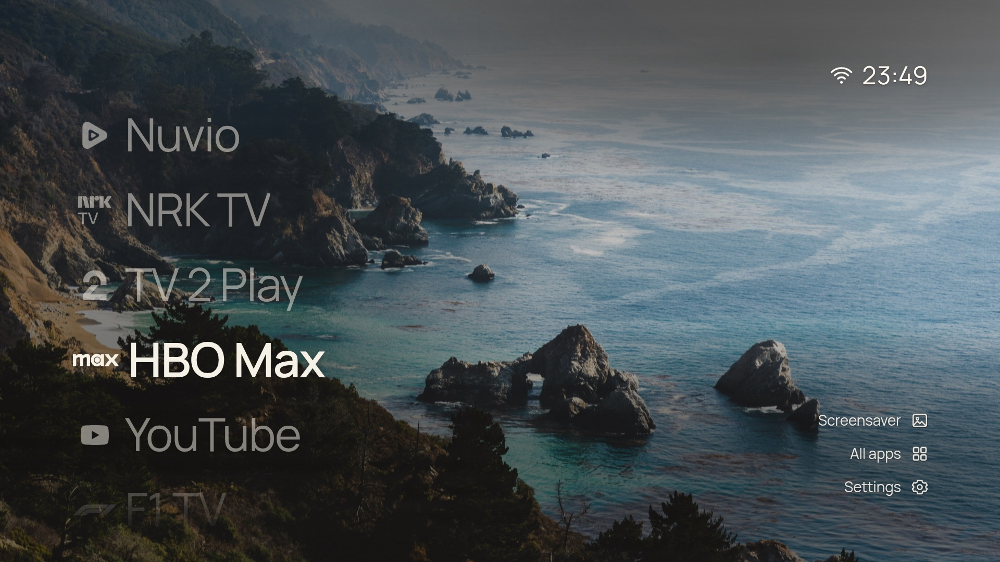
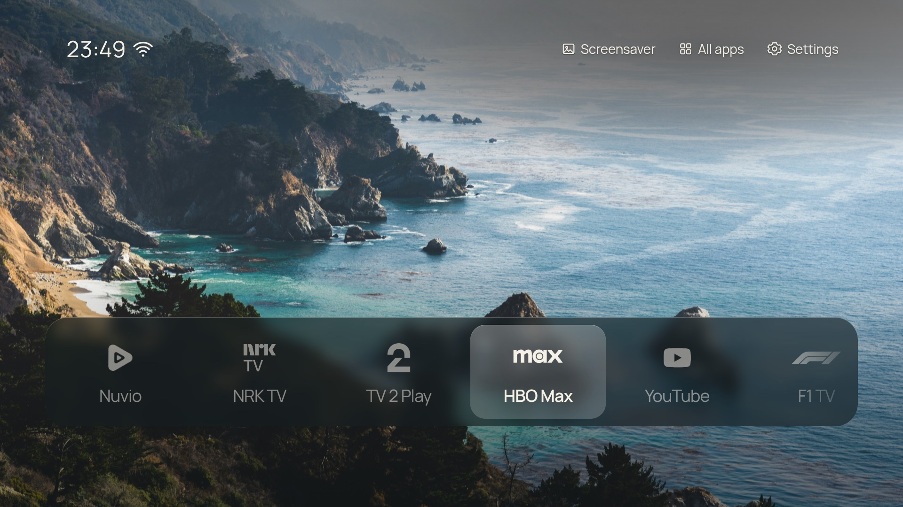
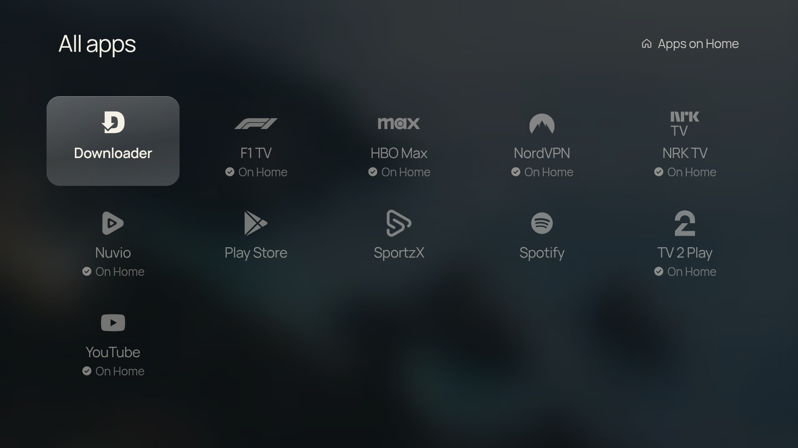
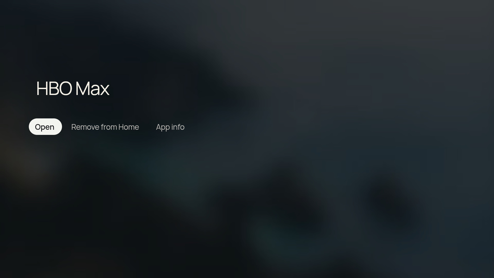

# CleanFrame for Android TV

A quiet home screen for Android TV: your apps, a photograph and the time, made for the remote.



This is a fork of [nthnclrk/CleanFrame](https://github.com/nthnclrk/CleanFrame), a home screen built for Samsung The Frame. The interface in `app/` is the same web UI; `android/` wraps it in a small Android app that runs as the TV's Home screen and replaces the Samsung (Tizen) calls with Android ones.

It runs on my Xiaomi TV Stick 4K (Android TV 11). Nothing in it is specific to that stick, but it is the only device it has been tested on.

## What's different from upstream

- **Runs on Android TV.** A WebView Home app lists and launches your installed apps, opens Settings and starts the screensaver (in place of Art Mode).
- **Monochrome marks for every app.** Apps without a bundled logo get a white mark made from their own icon, so the whole screen keeps one look.
- **Hold OK on an app** for a menu: Open, Add to or Remove from Home, and App info (the system screen for force stop, storage and uninstall). A short press still launches.
- **Wi-Fi beside the clock.** The arcs show signal strength; a slash means no connection or no internet.
- **Clearer focus.** Unfocused apps fade to half, and with Manrope the focused item steps from 400 to 600 weight.
- **More space between List rows**, with five rows still visible.
- **The clock follows the TV's 12/24-hour setting.**

<table>
  <tr>
    <td></td>
    <td></td>
  </tr>
  <tr>
    <td>Dock layout, Glass focus</td>
    <td>All apps</td>
  </tr>
  <tr>
    <td></td>
    <td></td>
  </tr>
  <tr>
    <td>Hold OK on an app</td>
    <td></td>
  </tr>
</table>

## Remote

| Key | Action |
| --- | --- |
| Arrows | Move focus |
| OK | Open the focused app or control |
| Hold OK | App menu (on Home and in All apps) |
| Back | Close a panel; on Home, offers the previous launcher |
| Home | Return to CleanFrame from anywhere |

Layout, background, wallpaper, font, focus style and the apps on Home are all in **Settings**.

## Install on your TV

You need JDK 17, the Android SDK platform tools (`adb`) and the TV on the same network as your computer.

1. On the TV, turn on **Settings → Device Preferences → About → Build** (press OK seven times), then **Developer options → USB debugging**.
2. Turn off any VPN on your computer; it can hide the TV from `adb`.
3. Build, install and set CleanFrame as Home:

   ```sh
   TV_HOST=192.168.0.67 android/install.sh
   ```

   Accept the debugging prompt on the TV the first time.

Your previous launcher stays installed. To switch back:

```sh
adb shell cmd package set-home-activity --user 0 <package>/<activity>
```

Use `adb shell cmd package query-activities -a android.intent.action.MAIN -c android.intent.category.HOME` to list the Home apps on the TV. See [android/README.md](android/README.md) for how the shell works and how to debug it.

## Try the interface in a browser

You need Node.js 22+ and Python 3.10+.

```sh
npm ci
npm run dev:public
```

Open [localhost:4795/home/](http://localhost:4795/home/) and use the arrow keys, Enter and Escape. Launching apps needs the TV, and the preview says so when you try; apps without a bundled logo show letters and the Wi-Fi icon is hidden.

## Develop

| Location | Purpose |
| --- | --- |
| `app/` | The UI: HTML, CSS and ES5 JavaScript. `device.js` talks to the Android bridge. |
| `android/` | The Android TV Home app that serves `app/` and provides the bridge |
| `scripts/` | Preview, checks and asset generation from upstream |
| `docs/` | Upstream's design and Samsung setup notes; the interaction and asset docs still apply |

Run `npm run check` after changing `app/`. Upstream's browser checks (`npm run check:browser`) were written for the Samsung app list and wording and haven't been updated for this fork.

## Licence and credits

CleanFrame's code and documentation use the [MIT licence](LICENSE); the original design and code are by [nthnclrk](https://github.com/nthnclrk/CleanFrame). Fonts, photographs and logos keep their own terms; read [THIRD_PARTY_NOTICES.md](THIRD_PARTY_NOTICES.md) and `app/assets/icons/`. The F1, NordVPN and Google Play marks come from [Simple Icons](https://simpleicons.org) (CC0).

This is an independent project with no affiliation to Samsung, Google, Xiaomi or any streaming service.
